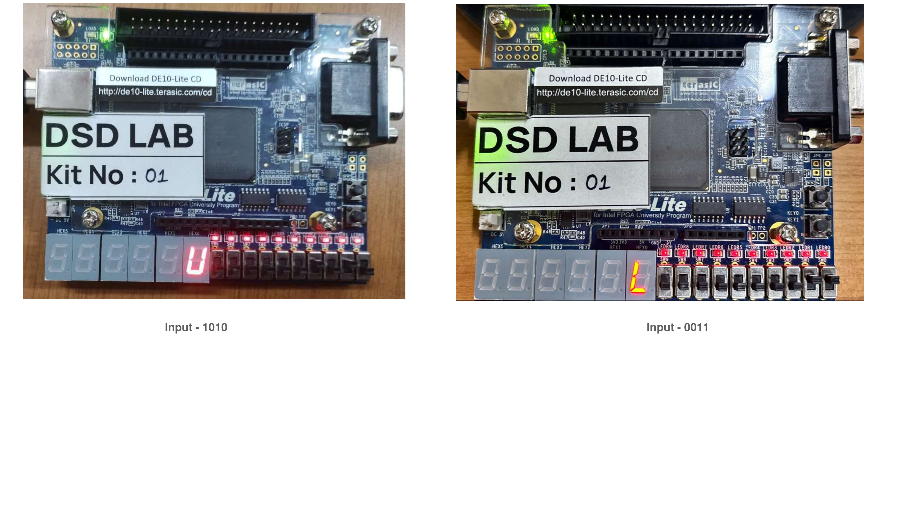
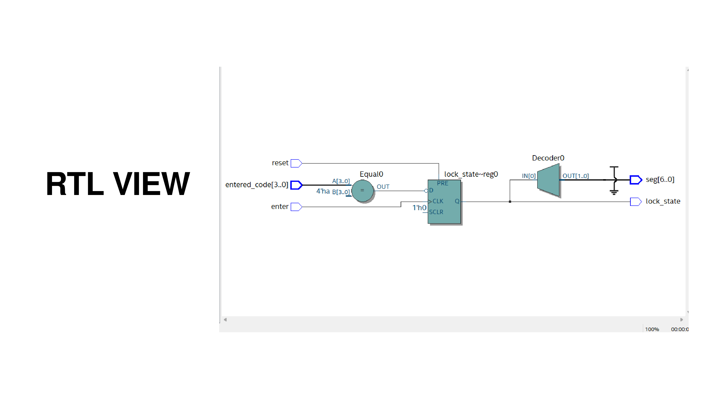
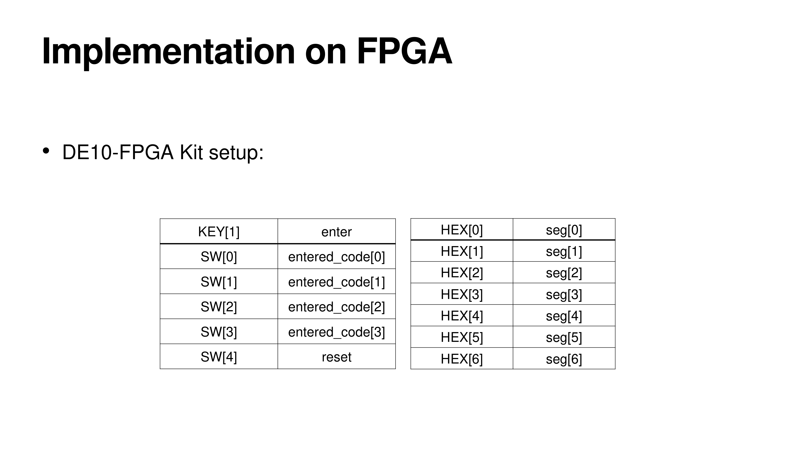

# Verilog-Digital-Safe-Lock
FPGA-based digital safe lock implemented using Verilog HDL with password verification, reset functionality, and seven-segment display output.

## Hardware Implementation

The design was implemented using Verilog HDL and Intel Quartus Prime.

### FPGA Board Results
The following images show the lock's output for a correct passcode (`1010`) and an incorrect passcode (`0011`).

### RTL View

### FPGA Signal Mapping

